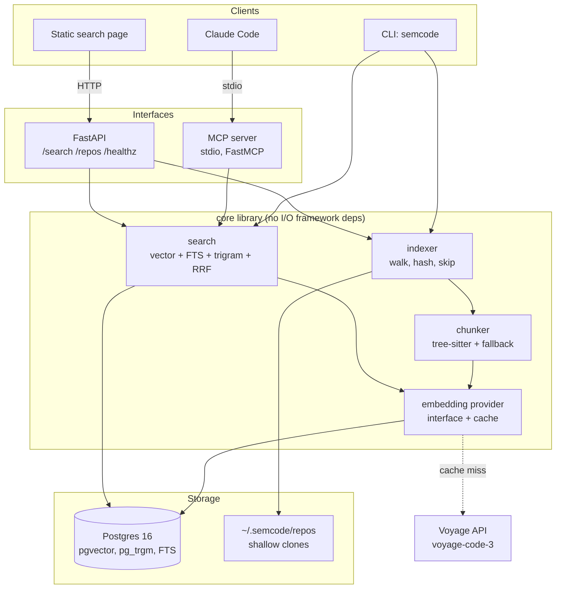
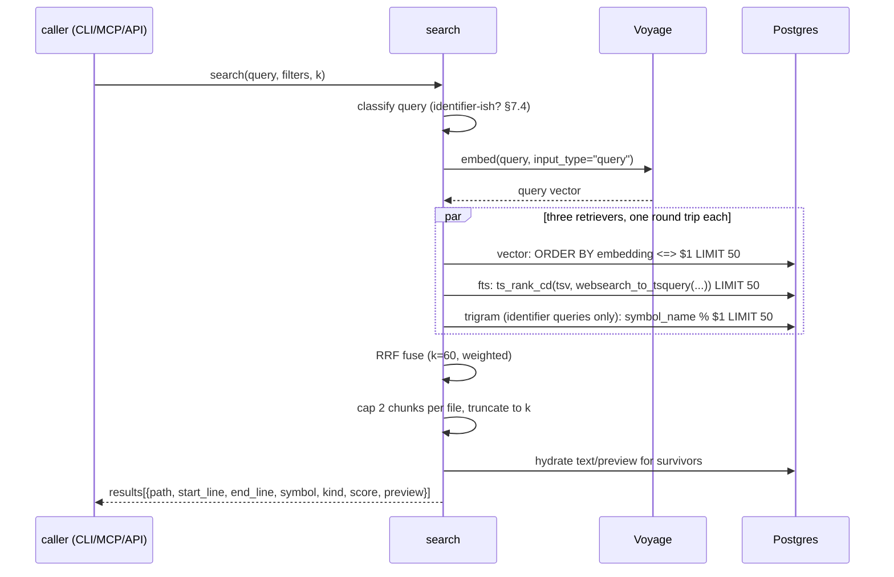

# semcode — Semantic Code Search for Claude Code

**Status:** spec, pre-implementation
**Author:** Shlok Powar
**Last updated:** 2026-10-13
**Timeline:** 3–4 weeks, solo, AI-assisted

---

## Reading notes

Every assumption is tagged **[A#]** and listed in §18. Where there is a real tradeoff, this spec
gives one recommendation with reasoning, not a menu. Numbers that must be *measured* are written
as `<MEASURE: ...>` and must never be filled in with guesses.

---

## 1. Problem statement, goals, non-goals

### 1.1 Problem

Claude Code explores a repository on demand. To answer "where does retry backoff get computed?"
it issues a sequence of `grep` / `glob` / `Read` calls, guessing at identifiers. Two failure modes
dominate:

1. **Vocabulary mismatch.** The user describes behavior ("rate limit the webhook sender"); the code
   says `_throttle_dispatch`. Grep for the description returns nothing, so the agent falls back to
   reading directory listings and plausible-looking files.
2. **Breadth cost.** On a large repo, a keyword that *does* hit returns 80 matches across tests,
   vendored code, and docs. The agent reads several irrelevant files before landing on the right one.

Both cost tool calls, tokens, and latency. Neither is a bug in Claude Code — it is the price of
having no index.

**This is a hypothesis, not an established fact.** The entire point of §9 is to measure whether an
index actually reduces that cost, and to report the result honestly even if the win is small or
absent. A spec that assumes its own conclusion is not an engineering document.

### 1.2 Goals

| # | Goal | How it is measured |
|---|------|--------------------|
| G1 | Given a natural-language description of behavior, return the code that implements it | recall@10 ≥ `<MEASURE: baseline + target>` on the frozen test set |
| G2 | Beat keyword-only and semantic-only retrieval | Hybrid MRR@10 > max(BM25, vector) on the test set |
| G3 | Reduce Claude Code's exploration cost on code-location tasks | Median tool calls and input tokens per task, A/B, §9.4 |
| G4 | Index a mid-size repo in minutes, re-index a changed file in seconds | Cold index ≤ `<MEASURE>` min for FastAPI; warm re-index of 1 file ≤ 5 s |
| G5 | Query latency low enough that an agent will actually use the tool | p95 end-to-end ≤ 500 ms, excluding embedding API |
| G6 | Every design decision is defensible in an interview | §16 written and rehearsed |

### 1.3 Non-goals (v1)

- **No answer generation.** Retrieval only. The tool returns locations; Claude Code reads and reasons.
- **No multi-user, no auth, no tenancy.** Single-user. Demo is read-only.
- **No private repos, no credentials.** Public GitHub repos and local folders only.
- **No languages beyond Python / JavaScript / TypeScript.** Not Go, not Rust, not Java.
- **No whole-repo semantics.** No call graph, no type resolution, no cross-file dataflow.
- **No editing, refactoring, or patch suggestion.**
- **No IDE plugin.** MCP + CLI + one web page.
- **No realtime file watching.** Re-index is an explicit command.
- **No distributed anything.** One Postgres, one process.

---

## 2. User stories and primary workflows

### 2.1 Stories

- **US1 — Index a public repo.** As a developer, I run one command with a GitHub URL and get a
  searchable index, with progress and a final count of files/chunks/tokens embedded.
- **US2 — Index a local folder.** Same, pointed at a working copy, so I can search code I'm editing.
- **US3 — Re-index after changes.** After `git pull` or local edits, I re-run index and only
  changed files are re-parsed and re-embedded; cost and time scale with the diff, not the repo.
- **US4 — Search from the CLI.** I describe behavior in English and get ranked `path:start-end`
  results with symbol names and a short preview, fast enough to use as a daily tool.
- **US5 — Search from Claude Code.** Claude Code calls `search_code` instead of grepping, gets a
  compact ranked list, and reads only the files it names.
- **US6 — Search from a browser.** A recruiter or interviewer opens the demo link, types a query
  against a pre-indexed FastAPI, and sees results without installing anything.
- **US7 — Evaluate.** I run one command and get a metrics table comparing BM25 / vector / hybrid
  on a frozen query set, reproducibly.

### 2.2 Workflows

**W1 — Index a repo (US1/US2)**
1. `semcode index https://github.com/tiangolo/fastapi` (or a path).
2. Shallow clone to a cache dir (`~/.semcode/repos/<owner>__<name>`) if a URL. Record HEAD SHA.
3. Walk the tree, apply skip rules (§5.5).
4. For each kept file: read bytes, compute `sha256`. If `(path, sha)` unchanged → skip entirely.
5. Parse with tree-sitter → chunks. On parse failure → sliding-window fallback.
6. Build `embed_text` per chunk (§5.4). Look up the embedding cache by `(model, sha256(embed_text))`.
7. Batch cache misses to the embedding API, 128 chunks per request, bounded concurrency.
8. Upsert files, chunks, embeddings in one transaction per file batch. Delete chunks for files that
   disappeared.
9. Print summary: files scanned/skipped/parsed/failed, chunks written, embeddings called vs cached,
   tokens, cost estimate, wall time.

**W2 — Re-index (US3)** Identical command. The `(path, sha256)` check in step 4 and the embedding
cache in step 6 make it incremental. A file whose content is unchanged costs one hash. A renamed
file costs one DB write and zero embedding calls (content-addressed cache hit).

**W3 — CLI search (US4)**
`semcode search "where is retry backoff computed" --repo fastapi -k 10 [--lang py] [--path-prefix src/] [--kind function] [--no-tests]`
→ embed query → vector + FTS + (if identifier-ish) trigram → RRF → file-diversify → print.

**W4 — Claude Code search (US5)** Claude Code spawns `semcode mcp` over stdio, calls `search_code`,
receives a compact text block, then `Read`s the ranges it cares about.

**W5 — Browser search (US6)** `GET /` serves one static page; it `POST`s to `/search` and renders
results with GitHub permalinks to the indexed SHA.

**W6 — Eval (US7)** `semcode eval --suite dev|test --methods bm25,vector,hybrid` → table + JSON
written to `eval/results/<timestamp>.json`.

---

## 3. System architecture

### 3.1 Components



**Hard rule: the MCP server and the HTTP API are both thin adapters over the same `core` package.**
No business logic in either. The MCP server calls Python functions directly — it does **not** call
the HTTP API. A local agent query must not require a running web server. **[A1]**

### 3.2 Indexing data flow

```mermaid
sequenceDiagram
  participant U as CLI
  participant W as walker
  participant C as chunker
  participant E as embedder
  participant D as Postgres
  participant V as Voyage

  U->>W: index(repo)
  W->>D: SELECT path, content_sha FROM files WHERE repo_id=$1
  W->>W: walk tree, apply skip rules, hash kept files
  W->>W: diff → added / modified / deleted / unchanged
  loop per changed file
    W->>C: parse(bytes, lang)
    alt parse ok
      C->>C: AST query → symbol chunks
    else parse error / minified
      C->>C: sliding-window fallback (or skip)
    end
    C->>E: chunks + embed_text
    E->>D: SELECT embedding FROM embedding_cache WHERE model=$1 AND text_sha=ANY($2)
    E->>V: POST /embeddings (misses only, batch 128)
    V-->>E: vectors
    E->>D: INSERT embedding_cache ON CONFLICT DO NOTHING
    E->>D: BEGIN; DELETE old chunks for file; INSERT chunks + embeddings; UPDATE files; COMMIT
  end
  W->>D: DELETE chunks/files for deleted paths
  W->>D: UPDATE repos SET head_commit, indexed_at
  U-->>U: print summary
```

### 3.3 Query data flow



**Why three separate queries, not one SQL statement with CTEs:** separate round trips are easier to
time individually (needed for §9), easier to disable for ablations, and let me set `hnsw.ef_search`
per-query without affecting the keyword path. Cost is two extra round trips to a local socket.
**[A2]** — if p95 blows the 500 ms budget, merge into one CTE query; measure first.

---

## 4. Data model

Postgres 16, extensions `vector` and `pg_trgm`. Migrations via raw SQL files applied in order
(`migrations/001_init.sql`, …) by a 30-line runner. **No Alembic** — one developer, forward-only,
no production data to protect. Documented shortcut, not an oversight.

### 4.1 Tables

```sql
CREATE TABLE repos (
  id              BIGSERIAL PRIMARY KEY,
  slug            TEXT NOT NULL UNIQUE,        -- 'tiangolo__fastapi', used by --repo
  source_url      TEXT,                        -- NULL for local-only
  local_path      TEXT,
  default_branch  TEXT,
  head_commit     TEXT,                        -- for GitHub permalinks + reproducible eval
  embedding_model TEXT NOT NULL,
  embedding_dim   INT  NOT NULL,
  chunker_version INT  NOT NULL,               -- bump → forces full re-chunk
  indexed_at      TIMESTAMPTZ,
  stats           JSONB NOT NULL DEFAULT '{}'  -- counts, timings, cost from last run
);

CREATE TABLE files (
  id           BIGSERIAL PRIMARY KEY,
  repo_id      BIGINT NOT NULL REFERENCES repos(id) ON DELETE CASCADE,
  path         TEXT   NOT NULL,                -- repo-relative, forward slashes
  lang         TEXT   NOT NULL,                -- 'python' | 'javascript' | 'typescript' | 'tsx'
  content_sha  TEXT   NOT NULL,                -- sha256 hex of raw bytes
  size_bytes   INT    NOT NULL,
  loc          INT    NOT NULL,
  parse_status TEXT   NOT NULL,                -- 'ok' | 'partial' | 'failed' | 'fallback'
  is_test      BOOLEAN NOT NULL DEFAULT FALSE,
  indexed_at   TIMESTAMPTZ NOT NULL DEFAULT now(),
  UNIQUE (repo_id, path)
);

CREATE TABLE chunks (
  id           BIGSERIAL PRIMARY KEY,
  repo_id      BIGINT NOT NULL REFERENCES repos(id) ON DELETE CASCADE,
  file_id      BIGINT NOT NULL REFERENCES files(id) ON DELETE CASCADE,
  kind         TEXT   NOT NULL,     -- function|method|class|class_header|interface|type|module_preamble|window
  symbol_path  TEXT,                -- 'APIRouter.add_api_route'; NULL for window/preamble
  symbol_name  TEXT,                -- 'add_api_route' — last segment, exact-match target
  start_line   INT NOT NULL,        -- 1-based, inclusive (what Read wants)
  end_line     INT NOT NULL,
  start_byte   INT NOT NULL,
  end_byte     INT NOT NULL,
  part_index   INT NOT NULL DEFAULT 0,   -- >0 for split huge functions
  part_total   INT NOT NULL DEFAULT 1,
  token_count  INT NOT NULL,
  text         TEXT NOT NULL,            -- raw source slice; powers preview + FTS
  keywords     TEXT NOT NULL,            -- identifier-split terms, see 4.3
  text_sha     TEXT NOT NULL,            -- sha256 of embed_text → cache key
  tsv          tsvector GENERATED ALWAYS AS (
                 setweight(to_tsvector('simple', coalesce(symbol_path,'')), 'A') ||
                 setweight(to_tsvector('simple', keywords), 'B') ||
                 setweight(to_tsvector('simple', text), 'C')
               ) STORED,
  UNIQUE (file_id, start_byte, end_byte, part_index)
);

CREATE TABLE chunk_embeddings (
  chunk_id  BIGINT NOT NULL REFERENCES chunks(id) ON DELETE CASCADE,
  model     TEXT   NOT NULL,
  embedding vector(1024) NOT NULL,
  PRIMARY KEY (chunk_id, model)
);

CREATE TABLE embedding_cache (
  model     TEXT NOT NULL,
  text_sha  TEXT NOT NULL,
  embedding vector(1024) NOT NULL,
  created_at TIMESTAMPTZ NOT NULL DEFAULT now(),
  PRIMARY KEY (model, text_sha)
);
```

### 4.2 Indexes

```sql
CREATE INDEX ON chunk_embeddings USING hnsw (embedding vector_cosine_ops)
  WITH (m = 16, ef_construction = 64);
CREATE INDEX ON chunks USING gin (tsv);
CREATE INDEX ON chunks USING gin (symbol_name gin_trgm_ops);
CREATE INDEX ON chunks (repo_id, kind);
CREATE INDEX ON chunks (file_id);
CREATE INDEX ON files (repo_id, path);
```

### 4.3 Rationale

- **Embeddings in their own table, keyed by `(chunk_id, model)`.** Lets two models coexist over one
  chunk set, so a model ablation is a `WHERE model = $1` instead of a re-index. Directly serves §9.
- **`embedding_cache` keyed by content hash, not chunk id.** A rename, a file move, or a re-clone
  re-pays zero dollars. Also makes a full re-chunk (bumping `chunker_version`) cheap if the chunk
  *text* is unchanged. Cheapest high-leverage decision in the schema.
- **`keywords` computed in Python, not SQL.** Postgres' `simple` config will not split
  `getUserById` into `get user by id`, and `to_tsvector` lowercases without segmenting. A ~15-line
  splitter (camelCase boundaries, `_`, `-`, `.`, digits) produces the terms, and the generated
  `tsv` indexes them at weight B. Alternative was a custom text search configuration — more Postgres
  surface area, no portability, harder to unit test.
- **Weighted `tsvector` (A: symbol path, B: split identifiers, C: body).** A query naming a function
  should rank that function above files that merely mention it.
- **Line *and* byte offsets.** Lines are the contract with Claude Code's `Read`; bytes are what
  tree-sitter emits and are unambiguous for slicing and for the `UNIQUE` constraint.
- **`text` stored in the DB.** The hosted demo has no checkout, and FTS needs it anyway. ~1–2 KB per
  chunk; for ~50k chunks that is tens of MB. Fine.
- **`chunker_version` on the repo.** Re-chunking is a correctness concern (bad boundaries poison
  every downstream metric); an explicit version makes "wipe and rebuild" a one-liner.
- **HNSW over IVFFlat.** HNSW needs no training set and no `lists` parameter tuned to row count,
  and stays good as rows are added incrementally — which is exactly the incremental-index workflow.
  IVFFlat builds faster and uses less memory; at ≤100k vectors neither matters. **[A3]**
- **`vector(1024)`, not `halfvec`.** 1024 float32 = 4 KB/row; 50k chunks ≈ 200 MB plus index.
  `halfvec(1024)` halves that at ~no recall loss and is the documented fallback if Neon's free tier
  storage binds (§12.4).
- **No `ON DELETE SET NULL`, no soft deletes.** Cascades everywhere; the index is derived data and
  can always be rebuilt.

### 4.4 Deliberately absent

No `symbols` table, no `imports`/`calls` edges, no `queries` log, no `users`. Each is a v1.5 item
(§14.3) and none is needed to answer "where is the code that does X".

---

## 5. Chunking strategy

Chunk = the unit that gets one embedding and one result row. For code search the right unit is the
**symbol** (function/method/class), because that is the granularity a developer thinks in and the
granularity a line range should point at.

### 5.1 Python (tree-sitter-python)

Captured node types → chunk kinds:

| Node | Kind | Notes |
|------|------|-------|
| `function_definition` at module level | `function` | includes preceding decorators and docstring |
| `function_definition` inside `class_definition` | `method` | `symbol_path = Class.method` |
| `class_definition` | `class_header` | signature + docstring + class-level assignments **only**; method bodies excluded (they are their own chunks) |
| `decorated_definition` | unwrap to inner def/class | decorators are semantically load-bearing (`@app.get("/items")`) and must be in the chunk text |
| module-level imports + constants | `module_preamble` | one chunk per file, capped; makes "what does this module configure" findable |

Nested functions (closures, decorators returning functions) are **not** emitted as separate chunks;
they stay inside the parent. A closure without its parent is rarely a useful search result, and
emitting both doubles near-duplicate vectors. **[A4]**

### 5.2 JavaScript / TypeScript (tree-sitter-javascript, tree-sitter-typescript, tsx)

| Pattern | Kind |
|---------|------|
| `function_declaration` | `function` |
| `variable_declarator` whose value is `arrow_function` / `function_expression` | `function` (name from the declarator) |
| `method_definition` in `class_declaration` | `method` |
| `class_declaration` | `class_header` (same body-exclusion rule as Python) |
| `interface_declaration`, `type_alias_declaration`, `enum_declaration` (TS) | `interface` / `type` |
| `export_statement` wrapping any of the above | unwrap; record `exported=true` in `keywords` |
| object-literal methods (`{ foo() {} }`) | `method`, `symbol_path = ObjVar.foo` when the parent variable is named |

TS/TSX needs a separate grammar from JS, and `.tsx` a separate one again from `.ts`. A JSX component
is just a function returning JSX — no special case; the normal function rule covers it. **[A5]**

### 5.3 Size policy

- Target 512 tokens, hard cap 1024 (`<MEASURE>` the actual distribution on the three eval repos and
  revisit).
- **Huge function (> cap):** split into overlapping windows at statement boundaries — never
  mid-expression — with ~15% overlap. Every part carries `part_index`/`part_total` and the same
  `symbol_path`, so results can report `foo (part 2/3)` and the fusion layer can collapse parts of
  one symbol into a single result spanning min(start)–max(end).
- **Tiny chunk (< 10 tokens, e.g. `def __repr__(self): return self.name`):** kept, not merged.
  Merging adjacent unrelated one-liners produces a chunk whose embedding means nothing. The cost of
  keeping them is a few cheap rows.
- **Huge class with 200 methods:** no special case — the header chunk is small by construction and
  each method is its own chunk.

### 5.4 Context prepending

Embedded text is **not** the raw slice. It is:

```
repo: tiangolo/fastapi
file: fastapi/routing.py
symbol: APIRouter.add_api_route (method)

    async def add_api_route(self, path: str, endpoint: Callable, ...) -> None:
        """Add an API route to the router."""
        ...
```

Rationale: path and symbol name carry real signal ("routing", "router") that the body may not
restate, and the embedding model sees them as natural language. **[A6] This is an assumption and
must be tested, not asserted** — Phase 6 runs an ablation (with vs. without the header) on the dev
set and the spec reports the delta. If it does not help, drop it; it costs tokens.

The `text` column stores the raw slice (no header) so previews and FTS are clean.

### 5.5 Skip rules and edge cases

Skipped before parsing:

- **Directories:** `node_modules`, `.git`, `venv`, `.venv`, `__pycache__`, `dist`, `build`, `out`,
  `.next`, `coverage`, `site-packages`, `vendor`, `third_party`, `.mypy_cache`, `.pytest_cache`.
- **Lockfiles & generated:** `package-lock.json`, `yarn.lock`, `poetry.lock`, `*.min.js`,
  `*.bundle.js`, `*.d.ts` (ambient declarations are mostly re-exported noise — **[A7]**, revisit if
  TS recall is bad), `*_pb2.py`, anything whose first 2 lines contain `@generated` or
  `DO NOT EDIT`.
- **Binary:** NUL byte in the first 8 KB → skip.
- **Too large:** > 1 MB → skip. > 128 KB → index but log.
- **Minified:** mean line length > 200 chars, or (lines < 10 and bytes > 50 KB) → skip with reason.
  Minified code chunks into garbage and poisons results; detection is two arithmetic checks.
- **Not a target language:** extension not in {`.py`, `.pyi`, `.js`, `.jsx`, `.mjs`, `.cjs`, `.ts`,
  `.tsx`}.
- **`.gitignore` is respected** via `pathspec`; `.semcodeignore` overrides if present.

Parse outcomes:

- **Clean parse** → symbol chunks, `parse_status='ok'`.
- **Partial parse** (tree contains `ERROR`/`MISSING` nodes, common with bleeding-edge syntax or the
  wrong grammar): keep symbol chunks from the clean subtrees, sliding-window the byte ranges covered
  by `ERROR` nodes, `parse_status='partial'`. Graceful degradation beats dropping the file.
- **Total failure / unsupported-but-text** → pure sliding windows of 60 lines with 10 lines overlap,
  `parse_status='fallback'`, `kind='window'`.
- **Empty or comment-only file** → no chunks, `parse_status='ok'`.

Both the skip counters and `parse_status` counts are printed by `index` and surfaced in
`repos.stats`. If `partial + failed` exceeds ~2% of files on an eval repo, that is a chunker bug to
investigate, not a number to hide.

**Tests are indexed, not skipped**, but flagged `files.is_test` (path matches `test_*`, `*_test.*`,
`/tests/`, `/__tests__/`, `*.spec.*`). Tests are often the best documentation of behavior; the
caller decides via `--no-tests`. Default for the MCP tool: **tests excluded**, because an agent
looking for an implementation almost never wants the test first. **[A8]**

---

## 6. Embedding model

### 6.1 Recommendation: Voyage `voyage-code-3`, hosted, 1024 dims

**Why hosted over local:** the whole project is 3–4 weeks. A local sentence-transformers model on
an M1 adds a 300–500 MB model download, a torch dependency, MPS-vs-CPU debugging, slow cold
indexing, and a deploy problem (the Fly box must then run inference). A hosted call is an HTTP
request with a retry wrapper. The engineering interest in this project is chunking, hybrid fusion,
and evaluation — not local model plumbing.

**Why Voyage over OpenAI:** `voyage-code-3` is trained specifically for code retrieval and supports
`input_type="query"` vs `"document"`, which is the asymmetric-embedding trick that matters when
queries are English and documents are code. OpenAI's `text-embedding-3-small` is cheaper and
general-purpose. **Both are behind the same interface, and Phase 6 benchmarks them head to head on
the dev set** — that comparison is itself a strong interview answer, and the schema (§4.1) was
designed to make it a `WHERE model=` change.

**Cost model** (fill from real pricing pages at implementation time; do not guess):
`tokens_to_embed ≈ chunks × avg_chunk_tokens × 1.15` (header overhead) `× $/1M`.
For the three eval repos combined: `<MEASURE: chunk count>` chunks → `<MEASURE: tokens>` →
`<MEASURE: $>`. Budget alarm at $20; the cache means re-indexing is near-free, so overruns can only
come from re-chunking, which is why `chunker_version` is explicit.

**Dimensions:** 1024. Under pgvector's 2000-dim index ceiling with headroom, and `voyage-code-3`
supports Matryoshka truncation to 512/256 if storage ever binds.

### 6.2 Latency and the query path

Query embedding is one network round trip (~50–150 ms, `<MEASURE>`), and it is on the critical path
for every search. Mitigations, in order of laziness:

1. `@lru_cache` on query embeddings in-process (eval replays the same queries hundreds of times —
   this alone makes the eval harness fast and cheap).
2. Fire the FTS/trigram queries concurrently with the embedding call, so the keyword path is free.
3. Nothing else. A 100 ms floor on an agent tool call that replaces 6 grep calls is not the problem.

### 6.3 Re-embedding strategy

Three distinct triggers, handled differently:

| Trigger | Response |
|---------|----------|
| File content changed | Re-chunk the file; `text_sha` lookup means unchanged *functions* in a changed file still hit cache |
| `chunker_version` bumped | Re-chunk the repo; most chunk texts are identical → cache hits → near-zero cost |
| Embedding model changed | Insert a new `(chunk_id, model)` row set; **old rows are kept**, so A/B is possible and rollback is a config flip |

A model swap is never destructive. `repos.embedding_model` records what the "live" model is, and
search filters on it.

### 6.4 Rejected

- **Local `bge-small-en-v1.5` / `jina-embeddings-v2-base-code`:** free and offline, but the time
  cost and deploy cost land in the wrong weeks. Moved to v1.5 (§14.3), where "I benchmarked a local
  model against a hosted one and here is the recall/latency/cost curve" becomes a *finished* story
  rather than a half-done dependency.
- **Fine-tuning anything.** No labeled training data, no time, no payoff.
- **LLM-generated chunk summaries before embedding ("contextual retrieval").** Real quality gains
  reported in the literature, but it is one LLM call per chunk — dollars and hours. v1.5.

---

## 7. Search design

### 7.1 Retrievers

1. **Vector.** `ORDER BY embedding <=> $qvec LIMIT 50`, `hnsw.ef_search = 100`
   (`<MEASURE>` the recall/latency curve over {40, 100, 200}).
2. **Full-text.** `ts_rank_cd(tsv, websearch_to_tsquery('simple', $q))` over the weighted `tsvector`.
   `websearch_to_tsquery` (not `plainto_`) because it tolerates quotes and `-exclusions` typed by a
   human and never raises on punctuation.
3. **Trigram symbol match** — *only for identifier-ish queries* (§7.4):
   `symbol_name % $q ORDER BY similarity(symbol_name, $q) DESC`, plus an exact
   `lower(symbol_name) = lower($q)` arm that is force-promoted to rank 1.

### 7.2 Fusion: weighted Reciprocal Rank Fusion

```
score(d) = Σ_r  w_r / (60 + rank_r(d))
```

**Why RRF over score normalization:** cosine distance, `ts_rank_cd`, and trigram similarity live on
incomparable scales with unstable distributions across queries. Min-max normalizing them per query
makes the fusion sensitive to the worst result in each list. RRF only uses ranks, has one parameter,
and is the standard result in the IR literature for exactly this situation. `k=60` is the canonical
default and will be sanity-checked on the dev set, not blindly trusted.

Weights `w_vec`, `w_fts`, `w_sym` are tuned by grid search on the **dev** set only (§9.2), and the
chosen values are frozen before the test set is touched. Expected starting point: `1.0 / 1.0 / 0.0`
for prose queries, `0.7 / 1.0 / 1.5` for identifier queries.

### 7.3 Post-processing

- **Collapse parts:** chunks sharing `(file_id, symbol_path)` merge into one result spanning the
  union of line ranges, keeping the best score.
- **File diversity:** at most 2 results per file (configurable). One sprawling file should not eat
  the top-10. This is the cheap substitute for MMR; if the eval shows redundancy is still hurting,
  MMR is a v1.5 item.
- **Filters** (all pushed into SQL `WHERE`, applied *before* the `LIMIT 50`, so filtering never
  silently empties the result set): `repo_slug`, `lang`, `path_prefix` (`path LIKE $1 || '%'`),
  `kind`, `exclude_tests`.
- **Score exposure:** the fused RRF score is returned but documented as *ordinal only* — it is not a
  probability and must not be thresholded. The MCP tool returns rank, not score (§8.4).

### 7.4 Identifier queries

Claude Code frequently searches for a literal name (`add_api_route`, `useEffect`, `AppConfig`). A
semantic index is the *wrong* tool for that and will happily return 10 semantically-similar
functions with the wrong name. Detection, in order:

```python
def classify(q: str) -> Literal["identifier", "prose", "mixed"]:
    t = q.strip()
    if " " not in t and re.fullmatch(r"[A-Za-z_$][\w$]*(\.[A-Za-z_$][\w$]*)*", t):
        return "identifier"            # add_api_route, APIRouter.include_router, useEffect
    if len(t.split()) <= 3 and any(_looks_like_ident(w) for w in t.split()):
        return "mixed"                 # "add_api_route decorator"
    return "prose"
```

- `identifier` → trigram + exact arm enabled, `w_sym` high; exact `symbol_name` match force-promoted.
- `mixed` → all three retrievers, moderate `w_sym`.
- `prose` → vector + FTS only.

**Why a regex and not an LLM classifier:** deterministic, zero latency, zero cost, unit-testable in
six lines, and the failure mode (misrouting a query to all three retrievers) is harmless because RRF
degrades gracefully. An LLM call here would add 500 ms and a failure mode to a tool whose entire
pitch is being cheaper than grep.

**The honest framing for an interview:** for pure identifier lookup, `grep` is already excellent and
semcode's job is to not be *worse*. The win is the prose and mixed cases. §9 must report the three
query classes separately rather than hiding a loss on identifiers inside an average.

---

## 8. MCP server design

Python MCP SDK (`mcp`), `FastMCP`, stdio transport. Registered in Claude Code via
`claude mcp add semcode -- semcode mcp`.

### 8.1 Tools

Three. Not eight. Every tool definition is tokens in every single request Claude Code makes, whether
or not it gets used — the tool surface is itself a cost.

#### `search_code`

```jsonc
{
  "query":        "string, required — natural language description or identifier",
  "repo":         "string, optional — repo slug; defaults to the only indexed repo if there is just one",
  "k":            "integer, default 8, max 25",
  "lang":         "enum: python|javascript|typescript, optional",
  "path_prefix":  "string, optional — e.g. 'src/' or 'fastapi/routing'",
  "kind":         "enum: function|method|class|interface|type, optional",
  "include_tests":"boolean, default false",
  "preview":      "enum: signature|body|none, default signature"
}
```

#### `get_code_context`

Given `repo`, `path`, and a line, returns the enclosing symbol's full text and exact line range.
This is the "I got a hit, now give me *just* that function, not the 800-line file" escape hatch —
it is the tool that actually saves tokens, because `Read` on a large file is the expensive thing.

#### `list_indexed_repos`

No args. Returns slug, language breakdown, file/chunk counts, indexed commit, indexed timestamp.
Cheap, and it stops the agent from guessing whether a repo is even indexed.

### 8.2 Rejected tools

`index_repo` (an agent should not trigger a multi-minute paid job mid-conversation),
`reindex`, `delete_repo`, `get_file`, `find_symbol` (that is `search_code` with
`kind` + an identifier query), `explain_code` (§1.3: retrieval only).

### 8.3 Output format

Text, not JSON. JSON spends tokens on punctuation and key names repeated per result, and the
consumer is a language model, not a parser.

```
semcode: 8 results for "where is retry backoff computed" in tiangolo__fastapi @ a1b2c3d

1. fastapi/routing.py:412-468 · APIRouter.add_api_route (method)
   async def add_api_route(self, path: str, endpoint: Callable, *, methods: list[str] | None = None) -> None:
2. fastapi/applications.py:901-934 · FastAPI.add_api_route (method)
   def add_api_route(self, path: str, endpoint: Callable, **kwargs: Any) -> None:
...

Read the ranges above directly. Narrow with path_prefix=, lang=, or kind=.
```

Rules:
- One line of location + one line of signature. `preview="none"` drops the signature line entirely.
- `path:start-end` in exactly the format `Read` accepts, so the agent copy-pastes rather than guesses.
- Rank numbers, **no scores** — a float invites the model to reason about a number that is not
  calibrated.
- The commit SHA appears once in the header, not per result.
- A fixed trailing hint, one line, teaching the filters.
- **Zero results** returns an explicit `semcode: 0 results … (tried vector+keyword)` plus the
  filters in effect — a silent empty response causes the agent to retry blindly.

**Token budget:** target ≤ 40 tokens/result, ≤ 400 tokens for a default k=8 response.
`<MEASURE: actual tokens/result via tokenizer>` and compare against
`<MEASURE: tokens from the grep+read sequence the agent would otherwise run>`. This comparison is a
headline result, so it must be measured, not estimated.

### 8.4 Tool description

The description is prompt engineering and deserves the same care as code. It must state when the
tool is *better* than grep (behavior described in prose, unknown identifier, large repo) and when it
is *not* (exact string, file you already know, non-indexed repo), and must name the indexed repos.
A tool that oversells itself gets called on everything and the A/B looks worse, not better.

---

## 9. Evaluation plan

This is the section that makes the project a *project* rather than a demo, and it is the section
most likely to be attacked in an interview. It is designed so that the headline numbers are hard to
dismiss as cherry-picked.

### 9.1 Two eval layers

- **L1 — offline retrieval.** Query set with gold `(file, line-range)` labels. Cheap, deterministic,
  repeatable thousands of times. This is the primary result.
- **L2 — end-to-end Claude Code A/B.** Expensive, noisy, small n. This is a *case study*, reported
  with explicit caveats, not a significance claim.

### 9.2 Query set construction (two tiers)

**Dev set (~30 queries), hand-written.** Written from each repo's README/docs **only**, before
looking at search results, then labeled by reading the code. Used for all tuning: RRF weights,
`ef_search`, chunk size, the context-header ablation, the model comparison.

**Test set (~50 queries), mined.** Harvested from closed GitHub issues that have a linked fix commit:

1. `gh` API → closed issues on flask/fastapi/express with a linked merged PR.
2. Filter: PR touches 1–3 source files (not docs/tests only), issue body is descriptive prose.
3. **Query** = the issue title (+ first paragraph if the title is too terse).
4. **Gold labels** = the functions/classes containing the lines the fix diff touched, resolved
   through the same chunker, pinned to the pre-fix commit.
5. Manual pass: discard queries that name the file or function outright (those test grep, not
   semantics), or whose gold location is wrong.

Why this matters: **I did not choose these queries and I did not choose the answers.** The hardest
version of "did you cherry-pick?" is answered by provenance, not by promises. The test set is
touched **exactly once**, at the end of Phase 6, after all parameters are frozen. Any later change
requires re-freezing and re-running everything, and the spec says so in writing.

Every query is tagged `identifier | prose | mixed` and `single-location | multi-location`, so
results can be broken down instead of averaged into mush.

Query sets live in `eval/queries/{dev,test}.jsonl`, committed, each entry carrying repo slug, commit
SHA, query, gold ranges, tags, and provenance (issue/PR URL or `hand-written`).

### 9.3 L1: metrics and baselines

**Metrics:** recall@{1,5,10}, MRR@10, nDCG@10, and p50/p95 latency per method. A result counts as a
hit if the returned line range **overlaps** the gold range (overlap, not containment — a chunk that
covers part of a long function is a successful find). Overlap is the right choice and must be stated
up front, because a strict-containment definition would quietly flatter the chunker.

**Baselines, strongest first:**

| Baseline | Why it is included |
|----------|--------------------|
| **`ripgrep` on query keywords** | This is the real competitor. It is what Claude Code actually does. Omitting it would make the whole eval dishonest. Implemented as: strip stopwords → rg each term → rank files by match count → map to enclosing symbols |
| **BM25 / Postgres FTS alone** | Isolates "better keyword search" from "semantic" |
| **Vector alone** | Isolates the embedding contribution |
| **Hybrid RRF** | The system |
| **Random / first-k-by-path** | Floor; catches a broken harness |

Ablations run on the dev set: context header on/off; chunk size 256/512/1024; `ef_search`
40/100/200; `voyage-code-3` vs `text-embedding-3-small`; weights grid.

### 9.4 L2: Claude Code A/B

**Setup.** `claude -p "<task>" --output-format json` in headless mode, run from a clean checkout of
each eval repo.

- **Control arm:** no MCP config. Claude Code uses its native grep/glob/read.
- **Treatment arm:** `--mcp-config` attaching semcode.

**Tasks.** 15–20 code-location tasks drawn from the **test** set (so the tasks are mined, not
authored), phrased as a fixed template: *"In this repository, find where <behavior> is implemented.
Reply with only the file path and line range."* 3 repetitions each → 90–120 runs total, within a Max
subscription.

**Measured per run,** from the JSON output and the session transcript
(`~/.claude/projects/<slug>/*.jsonl`; verify field names at implementation time):
`num_turns`, tool-call count by tool name, input/output/cache tokens, wall-clock, reported cost, and
**success** = does the final answer's cited range overlap the gold range (auto-graded by the same
overlap function as L1, with a manual spot-check of ~20% for grading bugs).

**Bias controls — these are the whole point:**

- Tasks and gold labels frozen **before** the MCP tool is tuned. Written into `eval/tasks.jsonl` with
  a git commit date that precedes Phase 4's tuning commits.
- Arms **interleaved** (A,B,A,B…), not blocked, so drift in service latency or model version hits
  both arms.
- Same pinned model, same temperature, same system prompt, same repo commit in both arms.
- **The treatment arm is charged for its own overhead:** the MCP tool definitions add tokens to
  every request in that arm. Those tokens are counted. Not counting them would be the single
  easiest way to fake a win.
- **Failures are reported, not dropped**, including runs where Claude Code *ignored* the tool and
  grepped anyway — that is a real and interesting outcome about tool descriptions.
- **Per-task table published**, not just aggregates, plus medians (not means — n is small and
  heavy-tailed) and bootstrap CIs over tasks. Raw JSONL logs committed to `eval/runs/`.
- Pre-registered analysis: the metrics, the success criterion, and the aggregation are written in
  `eval/PREREGISTRATION.md` and committed before the first run.

**What I will not claim.** With n≈20 tasks on 3 repos, this does not establish a general result
about agentic coding. It is evidence about *these tasks on these repos with this model version*, and
the README will say exactly that. **Being the person who states the limits of their own benchmark is
worth more in an interview than a bigger number.** If the result is "no significant difference" or
"worse on identifier tasks, better on prose tasks," that is the finding and it gets reported.

---

## 10. API and CLI surface

### 10.1 HTTP (FastAPI)

| Method | Path | Notes |
|--------|------|-------|
| `POST` | `/search` | body = the `search_code` params; returns JSON results |
| `GET`  | `/repos` | indexed repos + stats |
| `GET`  | `/repos/{slug}/chunks/{id}` | one chunk's full text + range |
| `GET`  | `/healthz` | DB connectivity + pgvector present + repo count |
| `GET`  | `/` | the static search page |

Indexing is **not** an HTTP endpoint in v1. It is a long, paid, filesystem-touching job; exposing it
on a public demo with no auth would be irresponsible. `SEMCODE_READ_ONLY=1` is set on the demo and
enforced at the router. Async indexing jobs (`POST /repos`, `GET /jobs/{id}`) are a v1.5 item.

Rate limit on the demo: 30 req/min/IP via `slowapi`, plus a hard `k ≤ 25`. The embedding API key
lives in one place and I am not funding a stranger's scraping run.

### 10.2 CLI (Typer)

```
semcode index <url|path> [--name slug] [--force] [--dry-run] [--max-files N]
semcode search <query> [--repo slug] [-k 10] [--lang py] [--path-prefix src/]
                       [--kind function] [--no-tests] [--json] [--method hybrid|vector|fts|rg]
semcode repos [--json]
semcode serve [--port 8000] [--reload]
semcode mcp                                  # stdio MCP server, what Claude Code spawns
semcode eval [--suite dev|test] [--methods ...] [--out path]
semcode db [init|reset|stats]
```

`--dry-run` on index (walk + chunk + report, no embedding, no writes) is the single most useful flag
in the whole tool while developing the chunker, and it costs nothing to add.

`--method` on search exists so the eval harness and the CLI share one code path. Two
implementations of search that can drift is how a benchmark becomes a lie.

---

## 11. Testing strategy

`pytest`. The goal is to make the *failure modes that silently corrupt results* loud, and to not
write tests for anything else.

**Chunker — golden-file snapshots (highest value).** `tests/fixtures/<lang>/*.{py,ts,js,tsx}`
with expected chunk boundaries as committed JSON. Fixtures cover: decorated functions, nested
classes, async methods, arrow-function consts, JSX components, TS interfaces/generics, a 900-line
function (split path), a deliberately syntax-broken file (partial path), a minified bundle (skip
path), an empty file, a comment-only file, a file with CRLF, a file with a BOM, a non-UTF8 file.
Boundary bugs are invisible downstream and poison every metric — this is where the tests go.

**Fake embedding provider.** Deterministic vector from `sha256(text)`, same interface. Every test
outside one live-API smoke test uses it. Tests must not cost money or need a network.

**Incremental indexing — behavioral.** Index a temp repo, assert N embed calls; re-index unchanged,
assert **0**; touch one file, assert only its chunks changed and embed calls ≤ chunks-in-that-file;
rename a file, assert 0 embed calls (cache hit); delete a file, assert its chunks are gone. These
assert the properties the feature exists for; a unit test of the hash function would not.

**Search — against a seeded DB.** Docker-compose Postgres in CI. Seeded fixture repo with known
content. Assert: filters actually filter, RRF ordering matches a hand-computed expectation on a
3-document toy case, identifier classification routes correctly, exact symbol match ranks 1,
file-diversity cap holds, empty result is well-formed.

**API** — `httpx.AsyncClient` against the app: happy path, validation errors (k=0, k=1000, unknown
repo, bad enum), `/healthz`, read-only mode rejects writes.

**MCP** — call the tool functions directly and assert the *rendered text* against a snapshot. The
output format is a contract with a language model; it should not change by accident. One
integration test spawns `semcode mcp` and does an `initialize` + `tools/list` handshake.

**Eval harness** — a 5-query mini-suite with a known-correct answer runs in CI, asserting the
metrics code itself is right (recall@k on a hand-computed case). A metrics bug that inflates the
headline number is the worst possible bug in this project.

**Not tested:** Typer wiring, FastAPI serialization, getters, the static page. YAGNI applies to
tests.

**CI** (GitHub Actions, on push): `ruff check`, `ruff format --check`, `pytest` with a
`pgvector/pgvector:pg16` service container. Target < 2 minutes. No mypy in v1 — type annotations
everywhere, but a gate that fights third-party stubs is a time sink at this scale.

---

## 12. Deployment

### 12.1 Topology

- **App:** one Docker container on **Fly.io**, `shared-cpu-1x`, 512 MB–1 GB, one region (`sjc`),
  `min_machines_running = 1` so a recruiter's click does not hit a 50-second cold start. That single
  line is the reason Fly beats Render's free tier here.
- **DB:** **Neon** Postgres with `vector` + `pg_trgm`. Neon runs pgvector on the free tier, and the
  branching feature makes "reset the demo index" trivial.
- **Secrets:** `fly secrets set VOYAGE_API_KEY=… DATABASE_URL=…`. Never in the image, never in git.
- **Image:** multi-stage, `python:3.12-slim`, `uv` for installs, non-root user. Pinned to 3.12 —
  the local machine has 3.14, where tree-sitter/ML wheels are not reliably available yet.

### 12.2 Indexing the demo repo

Indexing runs **from my laptop against Neon**, not on the Fly box: the box has no checkout, little
RAM, and no reason to hold a clone. The demo index is built once (FastAPI @ a pinned commit), and
refreshing it is re-running one local command. The app container is read-only by configuration.

### 12.3 Demo contents

FastAPI at a pinned SHA, plus flask and express if storage allows. The landing page states:
what is indexed, at which commit, which embedding model, and — crucially — a link to the eval
results. A demo that shows its own benchmark is a different artifact than a demo that shows a
search box.

### 12.4 Capacity and the known risk

1024-dim float32 = 4 KB/vector; HNSW adds roughly 1.5–2× on top. Estimate before deploying:
`<MEASURE: chunks for FastAPI>` → `<MEASURE: MB>`. If Neon's free storage binds, in order:
(1) switch to `halfvec(1024)` — half the bytes, negligible recall cost;
(2) truncate to 512 dims (Matryoshka);
(3) index FastAPI only.
Decision point is end of Phase 6, before Phase 7 begins, so it never becomes a launch-day surprise.

### 12.5 Local developer setup

`docker compose up -d` (Postgres + pgvector) → `semcode db init` → `semcode index <path>`.
Three commands in the README, verified on a clean clone in Phase 7. A project nobody can run is a
project nobody will look at.

---

## 13. Project phases

Every phase ends with something demoable. If week 3 explodes, whatever exists is still shippable.

---

### Phase 0 — Groundwork
**Goal:** a repo where a trivial change can be written, tested, and run in one command.
**Duration:** 0.5 day (~4 h) · **Depends on:** nothing

**Scope:** repo + `uv` project (Python 3.12); package layout (`semcode/{core,cli,api,mcp}`);
`docker-compose.yml` with `pgvector/pgvector:pg16`; `migrations/001_init.sql` with the full §4
schema; the 30-line migration runner; `semcode db init|reset|stats`; config via pydantic-settings
+ `.env.example`; `ruff`; GitHub Actions running `ruff` + `pytest` with a Postgres service; one
smoke test; `SPEC.md` committed.

**Deliverables:** green CI badge · `semcode db init` creates every table and index on a fresh DB ·
`semcode --help` runs.

**Exit criteria:** clean clone → `docker compose up -d && semcode db init && pytest` works with no
manual steps. `db stats` prints zeros.

**Risks:** pgvector extension install; HNSW index creation on an empty table. **Cut if over:** the
GH Actions workflow — run tests locally and add CI in Phase 7.

---

### Phase 1 — Thin end-to-end slice
**Goal:** index a real repo and get a semantically sensible result from the CLI.
**Duration:** 3 days (~18 h) · **Depends on:** 0

**Scope:** file walker + skip rules (§5.5) + hashing; tree-sitter **Python only**; function/method/
class_header chunking; `embed_text` with context header; `EmbeddingProvider` interface + Voyage
implementation + fake implementation + `embedding_cache`; batch embed with retry/backoff; writes to
`files`/`chunks`/`chunk_embeddings`; **vector-only** search; `semcode index`, `semcode search`,
`semcode index --dry-run`; chunker golden fixtures for Python.

**Deliverables:** flask indexed end to end · `semcode search "how are blueprints registered"`
returns correct `path:line-range` results · index summary prints counts/tokens/cost/time.

**Exit criteria:** on 5 hand-checked flask queries, the right function appears in the top 10 at
least 3 times. Dry-run chunk distribution looks sane (no 1-line and no 5000-line chunks). Cost for
flask recorded.

**Risks:** tree-sitter query syntax eats a day (mitigate: start from the grammar repo's own
`tags.scm`); API rate limits (mitigate: fake provider while iterating, `--max-files` caps).
**Cut if over:** `module_preamble` chunks; cost reporting.

**→ Demoable:** "semantic search over flask, from scratch, works."

---

### Phase 2 — Hybrid search
**Goal:** the retrieval quality story, with evidence that the hybrid is worth its complexity.
**Duration:** 3 days (~18 h) · **Depends on:** 1

**Scope:** identifier-splitting `keywords` + generated `tsv`; FTS retriever; trigram + exact-match
retriever; query classifier (§7.4); weighted RRF; part-collapsing; file-diversity cap; all filters
pushed into SQL; `--method` switch (hybrid/vector/fts/rg) sharing one code path; the **30-query
hand-written dev set** with gold labels; a *minimal* metrics script (recall@k, MRR) so tuning is
measured, not vibed.

**Deliverables:** `eval/queries/dev.jsonl` committed · `semcode eval --suite dev` prints a 4-method
table · tuned RRF weights committed with the numbers that justified them.

**Exit criteria:** hybrid MRR@10 ≥ both single-method baselines on the dev set. Exact identifier
queries return the exact symbol at rank 1. Filters verified by test.

**Risks:** FTS on `simple` config under-splitting identifiers (that is what `keywords` is for —
assert it with a test); dev set labeling is tedious and will take longer than it looks (~4 h alone).
**Cut if over:** the trigram retriever (keep the exact-match arm — it is a `WHERE` clause and
carries most of the identifier benefit).

**→ Demoable:** "hybrid beats either half, and here is the table."

---

### Phase 3 — Incremental re-indexing
**Goal:** re-indexing costs the diff, not the repo.
**Duration:** 1.5 days (~9 h) · **Depends on:** 1

**Scope:** path+sha diff (added/modified/deleted/unchanged); per-file transactional replace;
orphan cleanup; cache-hit accounting in the summary; `--force`; `chunker_version` invalidation;
the behavioral tests from §11.

**Deliverables:** re-index of unchanged flask reports 0 embedding calls and finishes in seconds ·
touch-one-file re-index touches only that file's chunks · rename costs 0 embeddings.

**Exit criteria:** all four incremental tests pass; `git pull` on a real repo then re-index behaves
proportionally to the diff.

**Risks:** partial-failure states leaving the index inconsistent (mitigate: one transaction per
file, and `parse_status` recorded so a bad file is visible rather than silently missing).
**Cut if over:** `chunker_version` auto-invalidation — `--force` covers it manually.

**→ Demoable:** "it is a tool you can keep pointed at a repo you are working in."

---

### Phase 4 — MCP server
**Goal:** Claude Code actually uses it.
**Duration:** 2 days (~12 h) · **Depends on:** 2

**Scope:** `semcode mcp` (FastMCP, stdio); the three tools (§8.1); the compact text renderer;
`get_code_context`; a carefully written tool description including when *not* to use it; token
measurement of the rendered output; snapshot tests; README install instructions.

**Deliverables:** `claude mcp add semcode -- semcode mcp` works · a transcript of Claude Code
answering a real question about FastAPI using `search_code` then `Read` · measured tokens per result.

**Exit criteria:** Claude Code calls the tool unprompted on a prose code-location question in a
repo it has never seen, and the answer is right. Output snapshot tests pass.

**Risks:** **the agent ignores the tool and greps anyway** — the top risk in the whole project. It
is a prompt-engineering problem in the tool description, and it needs real iteration budget. If it
persists, that becomes a reported finding in §9, not a hidden failure. Also: stdio servers must
never print to stdout (logging goes to stderr or a file, or the protocol breaks).
**Cut if over:** `get_code_context`.

**→ Demoable:** the money shot — a recording of Claude Code using your index.

---

### Phase 5 — API and web page
**Goal:** a link someone can click.
**Duration:** 1.5 days (~9 h) · **Depends on:** 2

**Scope:** FastAPI app, the §10.1 endpoints, pydantic request/response models, read-only mode flag,
rate limit; one static HTML page (search box, filters for lang/kind/tests, results with symbol +
range + preview + GitHub permalink at the indexed SHA, visible latency); API tests.

**Deliverables:** `semcode serve` → working page at `localhost:8000` · `/healthz` · OpenAPI docs.

**Exit criteria:** search works from the browser against a locally indexed repo; permalinks open the
right lines on GitHub; `k` and filter validation rejects bad input.

**Risks:** CSS rabbit hole. Budget: one file, no framework, no build step, ~150 lines. Plain HTML +
`fetch`. **Cut if over:** everything but the search box and the result list.

**→ Demoable:** a URL.

---

### Phase 6 — Evaluation
**Goal:** defensible numbers.
**Duration:** 3.5 days (~20 h) · **Depends on:** 2, 4

**Scope:** full metrics (recall@{1,5,10}, MRR@10, nDCG@10, latency percentiles); the `ripgrep`
baseline; **JS/TS support finished** so express is indexable (grammar wiring, the §5.2 patterns,
TS/TSX fixtures); the **mined 50-query test set** (`gh` harvesting script + manual filter);
`eval/PREREGISTRATION.md` committed before any A/B run; the Claude Code A/B harness (headless runs,
interleaved arms, transcript parsing, auto-grading, per-task table); ablations (context header,
chunk size, `ef_search`, Voyage vs OpenAI); `eval/RESULTS.md` with tables, caveats, and raw logs.

**Deliverables:** `eval/RESULTS.md` · `eval/queries/test.jsonl` with provenance · `eval/runs/*.jsonl`
· results broken out by query class (identifier/prose/mixed) and by repo.

**Exit criteria:** test set run **once**, after freezing every parameter. A/B complete with ≥15 tasks
× 3 reps, both arms, interleaved. Every number in `RESULTS.md` is reproducible by a committed
command. Limitations section written.

**Risks:** this phase is the most likely to overrun and the most valuable — protect it by starting
the mined test set early (it is scriptable and can run in the background during Phases 4–5).
Secondary: the A/B shows no win. That is an acceptable outcome *if reported honestly*; it is a
disaster only if discovered in week 4 with no time to write it up.
**Cut if over, in this order:** nDCG → the OpenAI model comparison → A/B reps 3→2 → JS/TS
(demote express to "Python-only v1, TS designed but unimplemented" and say so plainly).

**→ Demoable:** the README table that makes this a project and not a toy.

---

### Phase 7 — Deploy and polish
**Goal:** a stranger can understand, run, and trust it in five minutes.
**Duration:** 2 days (~12 h) · **Depends on:** 3, 5, 6

**Scope:** Dockerfile + `fly.toml`; Neon provisioning; demo index built from laptop → Neon;
read-only + rate limits verified in prod; README (what/why/architecture diagram/results table/
install/demo link/limitations); architecture diagram rendered; a 60–90 second demo GIF of Claude
Code using the MCP tool; resume bullets filled with real measured numbers; CI green; clean-clone
setup verified on a fresh directory.

**Deliverables:** live demo URL · README with real numbers · demo GIF · tagged `v1.0.0`.

**Exit criteria:** demo loads in < 2 s cold and returns results; a clean clone reaches a working
local search in three commands; README has zero placeholder numbers left.

**Risks:** Neon storage limit (decided at end of Phase 6, §12.4); secrets leaking into the image
(gitleaks pre-commit, and the key is rotatable).
**Cut if over:** the GIF → the hosted demo (README + local instructions still carry the project).

**→ Demoable:** everything.

---

### Phase totals

| Phase | Days | Hours |
|-------|------|-------|
| 0 Groundwork | 0.5 | 4 |
| 1 Thin slice | 3 | 18 |
| 2 Hybrid search | 3 | 18 |
| 3 Incremental | 1.5 | 9 |
| 4 MCP | 2 | 12 |
| 5 API + page | 1.5 | 9 |
| 6 Evaluation | 3.5 | 20 |
| 7 Deploy + polish | 2 | 12 |
| **Total** | **17** | **~102** |

Against a 60–80 h budget this is **over by ~20–40 h**, and that is stated deliberately rather than
massaged. The gap is closed by the cut list in §14.2 — which is why every phase carries its own
"cut if over" line. The realistic v1 is Phases 0–7 with the Phase 6 cut list applied and
JS/TS possibly demoted. **Python-only, fully evaluated, honestly reported beats two languages
half-measured.**

---

## 14. Week-by-week milestones

### 14.1 Schedule (v1, ~60–80 h)

| Week | Phases | Milestone (end of week) |
|------|--------|-------------------------|
| **1** | 0, 1, start 2 | flask indexed; vector search returns correct results from the CLI; dev query set started |
| **2** | 2, 3, 4 | Hybrid beats both baselines on the dev set; incremental re-index proven; **Claude Code is using the MCP tool** |
| **3** | 5, 6 | Demo page working locally; JS/TS landed; mined test set built; A/B runs executing |
| **4** | 6 finish, 7 | `RESULTS.md` with frozen test-set numbers; deployed demo; README; GIF; v1.0.0 tagged |

Background work that does not block: the mined test set is scriptable and should be harvested
during week 2–3 idle time. Labeling the dev set is the one unavoidable manual slog — do it in week 1
while chunker work is fresh, not in week 3 under pressure.

### 14.2 Cut order if behind (first cut at the top)

1. **v1.5 items** — never start them (§14.3).
2. **The OpenAI-vs-Voyage model comparison.** Nice ablation, not load-bearing.
3. **nDCG and bootstrap CIs.** recall@k + MRR + a per-task table is enough.
4. **The demo GIF.**
5. **JS/TS support → Python only.** Drop express. Say so explicitly in the README; a scoped-down
   claim is credible, an over-claimed one is not.
6. **A/B repetitions 3 → 1**, tasks 20 → 12. Report the smaller n with wider caveats.
7. **The trigram retriever** (keep the exact-match arm).
8. **The hosted demo.** README + local-run instructions + screenshots.
9. **`get_code_context` MCP tool.**
10. **Incremental re-indexing → `--force` full re-index only.** *Painful — this is a top-3 interview
    talking point. Cut it only if week 4 is on fire.*

**Never cut:** the offline eval with the `ripgrep` baseline, the MCP server, honest reporting of
negative results. Those three *are* the project. A search tool with no evaluation is a weekend
tutorial; an evaluated one with a negative finding is an engineering project.

### 14.3 v1.5 — what takes this from ~80 h to ~100 h+

Each item is independent and additive. None is started before v1.0.0 is tagged.

| Item | Est. | Why it is worth it |
|------|------|--------------------|
| **Local embedding provider + head-to-head benchmark** (`bge-small-en-v1.5`, `jina-v2-base-code` on M1) | 8 h | Turns "I picked hosted" into "I measured recall/latency/cost across three models." Strongest single addition. |
| **Reranking stage** (Voyage `rerank-2` or a local cross-encoder over the top 50) | 6 h | Usually the single largest recall@10→precision@5 jump in a RAG-ish system; measurable, and the "two-stage retrieval" story is standard industry architecture. |
| **Async index jobs** (`POST /repos`, `GET /jobs/{id}`, worker, progress) | 8 h | Makes the hosted demo self-serve: a visitor indexes their own repo. Big demo upgrade, needs real abuse-protection thought. |
| **Call-graph neighbor expansion** (tree-sitter call sites → 1-hop expansion of top hits) | 10 h | The most *technically* interesting item: structure-aware retrieval beyond flat chunks. Also the easiest to over-build. |
| **Contextual retrieval** (LLM-written one-line summary prepended per chunk, cached) | 6 h | Literature-backed quality gain; costs an LLM call per chunk. Measure, do not assume. |
| **Scale test on a large repo** (django or vite, 100k+ LOC) | 6 h | Produces an index-time/query-latency/storage curve and probably exposes a real bottleneck. Good "what broke at scale" story. |
| **Incremental via `git diff`** instead of full-tree hashing | 4 h | Skips the walk entirely between two commits. |
| **Multi-repo search** (one query across all indexed repos, repo-aware fusion) | 4 h | Nearly free given the schema. |
| **Distribution** (GHCR image + `pipx install semcode`) | 4 h | Someone else can actually run it. |
| **Query-log analysis** (log queries + clicks on the demo, report what people search for) | 4 h | Product instinct, not just engineering. |

Recommended v1.5 order: reranker → local-model benchmark → scale test. Those three are the ones an
interviewer will ask follow-ups about.

---

## 15. Risks and mitigations

| # | Risk | Likelihood | Impact | Mitigation |
|---|------|-----------|--------|------------|
| R1 | **Claude Code ignores the MCP tool and greps anyway** | Med-High | High — kills the headline result | Invest real time in the tool description (§8.4); measure tool-selection rate explicitly; if it persists, report it as a finding about tool-description design rather than burying it |
| R2 | **The A/B shows no improvement** | Medium | Medium | Framed from day one as a hypothesis test. A null result with a clean methodology is a legitimate and *interesting* outcome; the retrieval-quality result (§9.3) stands independently |
| R3 | Chunk boundary bugs silently degrade everything | Medium | High | Golden-file fixtures in Phase 1 before any scale-up; `--dry-run` distribution check; `parse_status` counters surfaced in every index summary |
| R4 | Dev-set labeling is slower and more subjective than expected | High | Medium | Do it in week 1; overlap-based grading; 30 queries not 100; mined test set provides labels you did not author |
| R5 | Neon free-tier storage insufficient | Medium | Medium | Measure before deploying; `halfvec` → 512-dim truncation → fewer repos (§12.4) |
| R6 | tree-sitter TS/TSX grammar friction | Medium | Medium | Start from each grammar's own `tags.scm`; TS is scheduled in Phase 6 where it is cuttable (§14.2 #5) |
| R7 | Embedding API cost or rate limits during iteration | Low-Med | Low | Fake provider for all dev work; content-addressed cache; `--max-files`; $20 alarm |
| R8 | Scope creep into answer generation / call graphs / more languages | High | High | §1.3 non-goals are binding; v1.5 list exists precisely so good ideas get *parked*, not pursued |
| R9 | Phase 6 overruns and the eval is rushed | High | **Highest** | Harvest the test set during weeks 2–3; pre-register the analysis; cut list ordered so eval depth is cut last |
| R10 | Python 3.14 / dependency wheel breakage | Low | Medium | Pin 3.12 in `.python-version`, CI, and Docker |
| R11 | stdout logging corrupts the MCP stdio protocol | Medium | Low (once known) | All logging to stderr; the `tools/list` handshake test catches it |
| R12 | Relying on background AI agents produces code you cannot explain | Medium | **High for the actual goal** | The project exists to be defended in interviews. Non-negotiable rule: nothing merges that you cannot explain line by line, and §16 gets rehearsed out loud before the first application goes out. Review every diff |

---

## 16. Decisions to defend in interviews

**1. Hybrid search over pure semantic.**
*Alternatives:* vector-only; keyword-only.
*Reasoning:* embeddings fail on exact identifiers (every function that "registers a route" looks
alike in vector space); keywords fail on vocabulary mismatch. They fail on **different** queries,
which is precisely when fusion helps.
*Tradeoff:* three retrievers, a fusion layer, weights to tune.
*Expect:* "How do you know the hybrid helps?" → the dev-set ablation table. "What if the vector
retriever is strictly worse?" → then RRF weights go to zero and I should ship keyword-only and say
so; that is what the ablation is for.

**2. RRF over score normalization.**
*Alternatives:* min-max or z-score normalize and weight; learning-to-rank.
*Reasoning:* cosine distance, `ts_rank_cd`, and trigram similarity are on incomparable, per-query
unstable scales. RRF uses ranks only, has one parameter, and is the standard IR answer here. LTR
needs training data I do not have.
*Tradeoff:* discards score magnitude, so a hit that is overwhelmingly best in one retriever gets no
extra credit.
*Expect:* "Why k=60?" → canonical default from the original RRF paper, sanity-checked on the dev set;
it damps the influence of deep ranks. "When would normalization win?" → when the scores are
calibrated and comparable, e.g. two embedding models on the same scale.

**3. Symbol-level chunking via tree-sitter over fixed windows.**
*Alternatives:* N-line windows; whole files; LSP/compiler-based symbol extraction.
*Reasoning:* a function is the unit a developer reasons in and the unit a line range should point
at. Fixed windows split functions mid-body and produce embeddings of partial logic. tree-sitter is
error-tolerant (it parses broken files, which an LSP often will not), fast, and needs no build
system or dependency install for the target repo — critical for indexing arbitrary public repos.
*Tradeoff:* a grammar + queries per language; no type resolution, no cross-file semantics.
*Expect:* "What about a 900-line function?" → split at statement boundaries with overlap, parts
tracked and re-collapsed at query time. "Why not an LSP?" → requires installing the repo's
dependencies and a running language server per project; enormous cost for type information this
tool does not use. "Why exclude method bodies from the class chunk?" → otherwise every method is
embedded twice, and near-duplicate vectors crowd the top-k.

**4. Postgres + pgvector over a dedicated vector DB.**
*Alternatives:* Qdrant/Weaviate/Pinecone; SQLite + sqlite-vec; FAISS + a sidecar store.
*Reasoning:* this system needs vector search, full-text search, trigram search, and relational
joins over the same rows. Postgres is the only one of those options that does all four, in one
query planner, with one backup story and one transaction. Splitting vectors from metadata means
two-phase queries and consistency bugs for no benefit at this scale.
*Tradeoff:* pgvector's HNSW is not as fast as a purpose-built engine at tens of millions of vectors,
and index builds are slower.
*Expect:* "At what point does this break?" → honest answer: single-node HNSW is comfortable into
the millions of vectors; past that I would shard by repo or move the vector tier out, and I would
want latency numbers before doing either. "Why not SQLite + sqlite-vec?" → genuinely the better
choice for a purely local-first tool, and I considered it; I chose Postgres because the hosted demo
needs a server anyway and FTS + trigram + vector in one engine is worth more than a single-file
index. I can argue the other side. *(Being able to argue the other side is the point.)*

**5. HNSW over IVFFlat.**
*Reasoning:* no training step, no `lists` parameter tied to row count, and quality holds as rows
are inserted incrementally — which is the incremental-indexing workflow.
*Tradeoff:* slower builds, more memory, `ef_search` to tune.
*Expect:* "What does `ef_search` do?" → candidate-list size at query time; higher = better recall,
higher latency. I have the curve on {40,100,200}. "What recall does your ANN index lose vs. exact?"
→ measured against an exact `ORDER BY` scan on the dev set.

**6. Hosted embeddings over local.**
*Reasoning:* a 3–4 week budget. Local inference adds a model download, torch, MPS debugging, slow
indexing, and an inference requirement on the demo box — none of which is the interesting part of
this project.
*Tradeoff:* cost per token, network dependency, a third-party in the loop, no offline use.
*Expect:* "What would you do differently for a company that cannot send code to a third party?" →
the provider interface exists for exactly that; swap in a local model, re-embed (the cache is keyed
by model, so both can coexist), and expect lower recall and slower indexing — magnitudes I would
measure before promising anything. "Why `input_type=query` vs `document`?" → asymmetric embedding:
English questions and code bodies are different distributions, and the model is trained to project
them into a shared space.

**7. Content-addressed embedding cache.**
*Reasoning:* keyed by `(model, sha256(embed_text))` rather than chunk id, so renames, moves,
re-clones, and even a full re-chunk cost nothing when the text is unchanged.
*Tradeoff:* one extra table and an extra lookup per chunk.
*Expect:* "What invalidates it?" → nothing; it is append-only and the key includes the model, so
entries can never be stale by construction. That is the advantage of content addressing. "What about
the context header changing?" → it is part of `embed_text`, so the hash changes and the cache
correctly misses.

**8. Retrieval only, no generation.**
*Reasoning:* the consumer is already a frontier model. Generating a summary would spend tokens and
latency to produce something Claude Code does better with the actual source in front of it. The
index's job is to tell it *where to look*.
*Tradeoff:* not a standalone Q&A product.
*Expect:* "How would you extend this to answer questions?" → I would not, in this architecture;
I would keep the tool as a retriever and let the agent compose. If a standalone product needed it,
the retriever is unchanged and a generation layer sits on top — which is exactly why the core
library has no framework dependencies.

**9. Three MCP tools, not ten.**
*Reasoning:* tool definitions consume context in every request in the session, used or not. A tool
whose job is to *save* tokens must not leak them through its own surface area.
*Tradeoff:* less functionality exposed; some operations need two calls.
*Expect:* "How did you decide the output format?" → measured tokens per result; text over JSON
because JSON repeats keys and punctuation per row and the consumer is a model, not a parser;
`path:start-end` in exactly the format `Read` accepts so the agent copies instead of guessing.

**10. Evaluation methodology — the one to lead with.**
*Reasoning:* a two-tier query set (hand-written dev for tuning, mined-from-GitHub-issues test
touched once), pre-registered analysis, `ripgrep` as the baseline that actually matters, interleaved
A/B arms, the treatment arm charged for its own tool-definition tokens, per-task tables and medians,
raw logs committed.
*Tradeoff:* a large slice of a short timeline spent on measurement instead of features.
*Expect:* "How do you know you did not cherry-pick?" → I did not write the test queries or choose
their answers; they come from closed issues with linked fix commits, and the set was frozen before
tuning and touched once. "Why mined queries?" → provenance is a stronger defense than a promise.
"What is your n and what does it support?" → ~20 tasks on 3 repos; that is a case study about these
tasks and this model version, not a general claim about agentic coding, and the README says so.
"What surprised you?" → `<MEASURE: fill in honestly after Phase 6>`.

**11. Python 3.12, `uv`, raw SQL migrations, no ORM.**
*Reasoning:* the queries here are vector/FTS/trigram operators and hand-tuned ranking SQL — exactly
what an ORM obscures. One developer, forward-only migrations, no production data: a 30-line runner
is sufficient, and Alembic would be ceremony.
*Tradeoff:* no automatic schema diffing; manual rollback.
*Expect:* "When would you add Alembic?" → a second developer, or data that cannot be rebuilt. Here
the index is derived data; the recovery plan is `db reset && index`.

---

## 17. Resume bullets

**Do not fill in a number until it has been measured.** Every `<MEASURE>` below maps to a specific
artifact in `eval/RESULTS.md`. An invented number is the fastest way to lose an interview, because
the follow-up question is always "how did you measure that?"

> **semcode — Semantic Code Search for AI Coding Agents** · Python, FastAPI, Postgres/pgvector,
> tree-sitter, MCP · *[demo](…) · [code](…)*
>
> - Built a hybrid code-retrieval engine over Python/JS/TS repos, combining HNSW vector search,
>   Postgres full-text search, and trigram identifier matching via weighted reciprocal rank fusion;
>   improved MRR@10 by **`<MEASURE: % over best single-method baseline>`** over keyword-only search
>   on a **`<MEASURE: N>`**-query benchmark derived from closed GitHub issues across 3 open-source
>   repositories.
> - Exposed the index to Claude Code as an MCP server; in a controlled A/B over
>   **`<MEASURE: N>`** code-location tasks, agent sessions using the tool used
>   **`<MEASURE: median tool calls, both arms>`** tool calls and **`<MEASURE: median input tokens,
>   both arms>`** input tokens vs. native grep-based exploration
>   *(**`<MEASURE: success rate, both arms>`** correct-location rate).*
> - Designed an AST-aware chunking pipeline (tree-sitter) emitting function/class-level chunks with
>   file-path and symbol context, handling oversized functions, partial parse failures, and minified
>   files; indexed **`<MEASURE: N>`** chunks across **`<MEASURE: N>`** files in
>   **`<MEASURE: time>`**.
> - Implemented content-addressed incremental re-indexing keyed by chunk-text hash, reducing
>   re-index cost after a typical commit from **`<MEASURE: full index time/cost>`** to
>   **`<MEASURE: incremental time/cost>`** and eliminating redundant embedding spend on file renames.
> - Deployed a read-only demo (Fly.io + Neon Postgres) with a pre-indexed FastAPI codebase; p95
>   query latency **`<MEASURE: ms>`** over **`<MEASURE: N>`** indexed chunks.

**Notes for the interview, not the resume:**
- Lead with bullet 2 only if the A/B shows a real effect. If it is null, lead with bullet 1 and the
  methodology — "I tested my own hypothesis and it did not hold on prose-heavy queries" is a
  *better* story than a vague improvement claim, and far harder to poke holes in.
- Always be ready to state the n and the limitations before being asked. Volunteering the caveat is
  what separates someone who ran a benchmark from someone who understands one.

---

## 18. Assumptions

| # | Assumption | How it gets validated / what breaks |
|---|-----------|-------------------------------------|
| A1 | MCP server and HTTP API can share one core library without framework coupling | Phase 4; if the MCP server needs an HTTP hop, local use would require a running server — unacceptable |
| A2 | Three separate SQL round trips stay inside the 500 ms p95 budget | Measured in Phase 2; fallback is one CTE query |
| A3 | ≤100k vectors, so HNSW vs IVFFlat is a non-decision on performance grounds | Chunk counts measured in Phase 1; revisit only on the v1.5 scale test |
| A4 | Nested/closure functions are not worth separate chunks | Dev-set recall in Phase 2; if closure-heavy JS recall is poor, emit them |
| A5 | JSX components need no special handling beyond the function rule | TSX fixtures in Phase 6 |
| A6 | **Prepending file path + symbol name to `embed_text` improves retrieval** | Explicit ablation in Phase 6. Flagged as the single most load-bearing unvalidated assumption in the chunking design |
| A7 | Skipping `*.d.ts` loses nothing important | TS recall in Phase 6; cheap to reverse |
| A8 | Agents want implementations, not tests, by default | `include_tests` is a parameter, so this is a default, not a constraint |
| A9 | Claude Code's transcript JSONL exposes per-message token usage | Verify in Phase 6 before building the A/B parser; fallback is `--output-format json` aggregate usage only |
| A10 | `claude -p` headless accepts `--mcp-config` and reports usage/turns in JSON | Verify in Phase 6 **before** designing the harness around it; fallback is manual interactive runs with transcript parsing |
| A11 | Neon's free tier includes pgvector and enough storage for ≥1 indexed repo | Verify in Phase 0 by creating the DB and running `CREATE EXTENSION vector` — do not wait until Phase 7 |
| A12 | ~20 A/B tasks × 3 reps fits within a Claude Max subscription's limits | Run 2 tasks end-to-end early in Phase 6 and extrapolate before committing to the full matrix |
| A13 | Mined GitHub issues yield ~50 usable queries after filtering | If the yield is low, fall back to a larger hand-written set and say so in `RESULTS.md` |
| A14 | The project lives in a fresh repo (`~/Desktop/semcode`), not in an existing one | Trivially true at Phase 0 |
